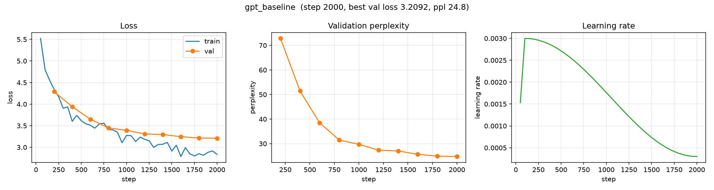

# Baseline: GPT (Decoder-only Transformer)

**Run name:** `gpt_baseline`
**Date:** 2026-10-08
**Status:** complete (2000 / 2000 steps)

## Purpose

The first transformer baseline for LLM-Lab: a small, decoder-only GPT trained
on Tiny Shakespeare. Built to validate the transformer architecture against the
existing harness and to compare with the LSTM baseline
([`lstm_baseline.md`](lstm_baseline.md)).

Notably, the GPT **outperforms the LSTM while being ~41% smaller** — see
[Comparison](#comparison-with-the-lstm-baseline).

## Setup

| | |
|---|---|
| Python | 3.13.7 |
| PyTorch | 2.14.1 |
| Device | Apple MPS (macOS arm64) |
| Corpus | Tiny Shakespeare (1,115,394 chars) |
| Tokenizer | byte-level BPE, `vocab_size = 1024` |
| Tokens | 459,913 total (413,921 train / 45,992 val) |
| Parameters | **932,608** |

### Model

- Decoder-only transformer, **pre-LN** blocks
- `n_layer = 4`, `n_head = 4`, `n_embd = 128` (`head_dim = 32`)
- Learned absolute position embeddings, `context_window = 64`
- GELU MLP with 4× expansion
- **Tied** input/output embeddings
- GPT-2-style init (`N(0, 0.02)`)

### Training

- `context_window = 64`, `batch_size = 32`
- AdamW, `learning_rate = 3e-3`, `weight_decay = 0.0`
- LR schedule: linear warmup (100 steps) + cosine decay to `min_lr_ratio = 0.1`
- `grad_clip = 1.0`, `max_steps = 2000`
- Eval every 200 steps; sample generation every eval

## Results

| Metric | Start | End (step 2000) |
|---|---|---|
| Train loss | 5.523 | 2.836 |
| Val loss | 4.289 (step 200) | **3.209** |
| Val perplexity | 72.9 | **24.76** |

Best validation loss: **3.2092** (perplexity **24.76**), reached at the final
evaluation — still improving, not plateaued.

### Validation loss over training

| Step | 200 | 400 | 600 | 800 | 1000 | 1200 | 1400 | 1600 | 1800 | 2000 |
|---|---|---|---|---|---|---|---|---|---|---|
| Val loss | 4.289 | 3.940 | 3.650 | 3.449 | 3.392 | 3.309 | 3.297 | 3.245 | 3.215 | 3.209 |
| Val ppl | 72.9 | 51.4 | 38.5 | 31.5 | 29.7 | 27.4 | 27.0 | 25.7 | 24.9 | 24.8 |

### Training curves



*Left: train/val loss. Middle: validation perplexity. Right: learning-rate schedule (warmup + cosine). Generated with [`scripts/plot_curves.py`](../../scripts/plot_curves.py).*

## Sample generations

Prompt: `ROMEO: `, `temperature = 0.8`, `top_k = 50`.

**Step 200 (early):**

```
ROMEO: anirce; for thou whilve a mack,
Tilleeping to Londerst.
...
Trir the none:
Oh, the earth, the natry, why, a cletenger:
```

**Step 2000 (final):**

```
ROMEO: Nreessibe;
For thy depart with braining favour
Strike fal with the ground of glory:
This man hath, moving me in his hand,
Bestride our i' the land, aside.

KING RICHARD III:
I pray, be gone, so your graceful.

BUCKINGHAM:
Why, what art thou that'st not sole to wander?
```

By step 2000 the output shows grammatical phrases, consistent speaker labels,
and blank-verse structure — qualitatively more coherent than the LSTM at the
same step.

## Comparison with the LSTM baseline

| Model | Params | Context | Val loss | Val perplexity |
|---|---|---|---|---|
| LSTM (`lstm_baseline`) | 1,577,984 | 64 | 3.255 | 25.92 |
| **GPT** (`gpt_baseline`) | **932,608** | 64 | **3.209** | **24.76** |

- The GPT reaches **lower validation loss with ~41% fewer parameters**
  (932,608 vs. 1,577,984).
- Both models were still improving at step 2000, so neither has converged.
- Qualitatively, the GPT's samples are more grammatical at the same step.

## Caveats

- **Data-limited.** Tiny Shakespeare (~0.46M tokens) is far too small for a
  meaningful architecture comparison; differences are partly noise and both
  models are compute-limited.
- **Not parameter-matched.** The GPT is *smaller* than the LSTM here, which
  makes its win notable but means this is not a controlled comparison.
- **Single seed.** One run each; no error bars.

The decisive, param-matched comparison will be run on a larger corpus
(TinyStories) in the next phase.

## Artifacts

```
artifacts/runs/gpt_baseline/
├── best.pt      # best validation loss checkpoint
├── latest.pt    # last checkpoint (step 2000)
└── tb/          # TensorBoard logs (scalars, config, samples, hparams)
```

## Reproduction

```bash
uv run python scripts/prepare_data.py --config configs/experiments/gpt_baseline.yaml
uv run python scripts/train.py --config configs/experiments/gpt_baseline.yaml
uv run tensorboard --logdir artifacts/runs
```

Config: [`configs/experiments/gpt_baseline.yaml`](../../configs/experiments/gpt_baseline.yaml)
