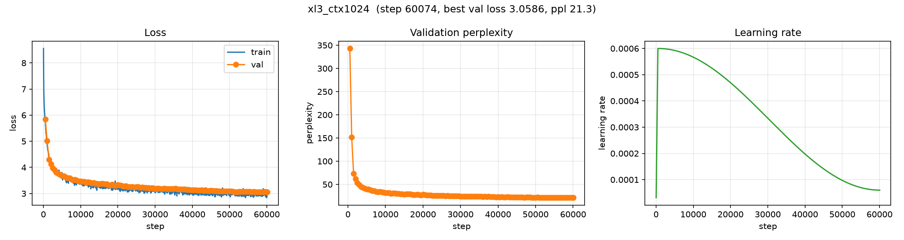

# Context length: 128 → 1024 (`xl3_ctx1024`)

**Experiment:** `context/xl3_ctx1024`
**Date:** 2026-10-16
**Status:** complete (60,074 steps · 1.97B tokens · 3.0 h)

## Purpose

Does a **GPT-2-style 1024-token** context window help, at the same
compute-optimal budget? **One change only** — the context window — against the
**Chinchilla `xl3` run** (context 128): same model, corpus and tokenizer, with the
data budget re-derived so both runs stay compute-optimal at `k = 20` tokens/param.

## Setup

| | ctx 128 (baseline) | **ctx 1024** |
|---|---|---|
| Model | `xl3` — GPT, 12L / 12H / 768d, tied | same architecture |
| Params `N` | 97,737,216 | **98,425,344** |
| Corpus | FineWeb-Edu (`sample-10BT`) | same |
| Tokenizer | byte-level BPE, vocab 16,384 | same (reused) |
| Data budget | 1,954,744,320 = k·N | **1,968,506,880** = k·N |
| Context | 128 | **1024** |
| tokens / step | 64 × 128 = 8,192 | 32 × 1024 = 32,768 |
| Steps | 238,616 | **60,074** |
| warmup / eval / log | 2000 / 2000 / 100 | 500 / 500 / 25 *(same in tokens)* |
| Optimizer | AdamW, lr 6e-4, cosine → 0.1×, clip 1.0 | same |
| Precision | AMP (`auto`) | same |
| Seed | 0 | 0 |

### Two mechanical consequences of the longer window

1. **The model gains a parameter.** Position embeddings are learned and absolute
   (`nn.Embedding(context_window, n_embd)`), so 128 → 1024 rows adds
   `(1024 − 128) × 768 = 688,128` parameters. `N` rises 0.70%, and the `k = 20`
   budget with it.
2. **The attention cost grows as O(L²).** At 1024 tokens the score matrix is
   `B × H × L²` — ~19 GB at batch 64 in bf16 — so **batch was halved to 32** to fit
   a 40 GB A100. The attention was also switched from a hand-written
   implementation to `F.scaled_dot_product_attention` (FlashAttention on CUDA),
   which never materialises that matrix.

`max_steps` is derived, not rounded: `1,968,506,880 / 32,768 = 60,074`.

## Results

| | ctx 128 | **ctx 1024** | change |
|---|---|---|---|
| **Best val loss** | 3.2563 | **3.0586** (step 58,500) | **−6.1%** |
| Best ppl | 25.95 | **21.30** | **−17.9%** |
| **Best bits/byte** | 1.089 | **1.023** | **−6.1%** |
| Final val loss | 3.2676 | 3.0639 | |
| Final train loss | ~3.31 | ~2.97 | |
| Wall-clock | 3.41 h | **3.02 h** | −11% |
| Throughput | 113,700 tok/s | **181,200 tok/s** | +59% |
| Instability? | none | none | |

**8× the context buys ~6% better bits-per-byte** — the largest single-variable
gain since the corpus swap, and it lands in the same −6% range as 12× more
compute did for the Chinchilla run.

A nice surprise: the longer-context run is **faster** in wall-clock, despite ~21%
more FLOPs (the extra O(L²) attention). SDPA/FlashAttention and better GPU
utilisation on 1024-token sequences more than pay for it.

### Validation loss over training (all 121 evals, every 500 steps)

```
5.838 5.024 4.298 4.132 3.982 3.899 3.808 3.762 3.723 3.678
3.670 3.624 3.588 3.600 3.542 3.521 3.538 3.505 3.476 3.469
3.458 3.454 3.411 3.447 3.430 3.401 3.417 3.374 3.382 3.358
3.372 3.380 3.369 3.360 3.322 3.323 3.347 3.303 3.298 3.333
3.323 3.298 3.277 3.285 3.262 3.255 3.252 3.261 3.235 3.263
3.253 3.230 3.245 3.220 3.219 3.205 3.208 3.218 3.209 3.186
3.196 3.190 3.183 3.180 3.193 3.181 3.183 3.180 3.179 3.184
3.199 3.163 3.171 3.159 3.167 3.161 3.144 3.144 3.127 3.132
3.127 3.132 3.126 3.120 3.129 3.110 3.127 3.103 3.107 3.116
3.101 3.100 3.106 3.088 3.093 3.092 3.095 3.088 3.081 3.083
3.090 3.067 3.065 3.064 3.073 3.077 3.075 3.072 3.068 3.067
3.067 3.065 3.073 3.062 3.061 3.059 3.059 3.060 3.071 3.065
3.064
```

Smooth and essentially monotone; best **3.0586 @ 58,500**, flat over the last
~10k steps.

### Training curves



*Train/val loss, validation perplexity, and the learning-rate schedule.*

## Sample generations

Prompt `The history of`, `temperature = 0.8`, `top_k = 50`.

**Step 2,000 — fluent but looping:**

```
The history of the U.S. Supreme Court in 1936, the United States Constitution was
the first governor to the United States by the United States. ... the last
amendment of the U.S. Supreme Court, the final amendment to the U.S. Supreme
Court in 1946. ...
```

**Step 27,000 — paragraph structure, invented history:**

```
The history of the British Empire must be preserved in the words of Sir William
Wythe, a wealthy, accomplished Englishman, who in his first letter to his father,
Sir William Wythe, described it as a 'uncle' in a pamphlet ...
```

**Step 60,074 — coherent multi-sentence register:**

```
The history of this topic is long but the most comprehensive and up-to-date
overview follows the history of the U.S. government.
The U.S. Constitution is the document that gives us the authority to conduct
government. It's important that we read this document. The U.S. Constitution is
the set of principles, frameworks, and legal guidelines that define our
government. ...
```

The progression is the familiar one: local fluency → paragraph structure →
multi-sentence register. The **form** is convincing; the **facts** are still
invented.

## Observations

1. **Long context helps, cleanly.** A −6.1% bits/byte gain from one variable, with
   no instability, on the same data budget.
2. **The gain is comparable to a much bigger compute step.** 12× the compute
   (Chinchilla vs the 164M-token run) also bought ~6%. Here 8× the context did the
   same — and it was *faster* in wall-clock.
3. **Train and val track each other** (2.97 vs 3.06). A healthy run: no
   overfitting, no divergence.
4. **The model has a parameter budget for context.** The position table grows with
   the window; at 16k vocab it is a small but real effect on `N` (+0.70%).

## A sampler bug worth recording

The first attempts at this run failed confusingly: **train loss collapsed to ~0.4
while val loss rose.** It looked like divergence (so we lowered the LR 6e-4 → 3e-4
→ 1e-4 — to no avail), then like overfitting.

It was neither. The culprit was the sampler.

A `ShuffledChunkSampler` had been introduced to give *full coverage without
replacement* (permute the chunk order, then permute within each chunk). But its
global mixing comes **only from moving between chunks**, so it is sound only when

```
shard_size  ≪  run_length
```

Ours was the opposite — `chunk_size = 1 << 20` windows ≈ the *entire* run
(1.9M windows) — so the first ~32,768 steps all came from a **single 1M-token
region**. The model saw ~1M unique token positions (of 1.97B), memorised them, and
validation loss rose. The LR sweep was chasing a phantom.

**The rule:** a shard shuffle is only sound when a run consumes *many* chunks.
For runs that see ≪ 1 epoch — all of ours — a **with-replacement** sampler is
correct: with `m/n ≈ 0.1%`, the draws are ~99.95% distinct, so the "wasted
coverage" is negligible while global mixing on every step is essential.

Both samplers now live in `src/llm_lab/data/sampler.py`. `ChunkedRandomSampler`
(with replacement) is the default; `ShuffledChunkSampler` emits a `UserWarning` on
construction and documents exactly when it *is* appropriate.

## Caveats

- **Single seed**; no error bars.
- **Batch 32 vs the baseline's 64** (memory-driven). This is therefore not a
  *perfectly* pure one-variable comparison — the smaller batch adds gradient noise.
- **Bits/byte uses the tokenizer-sweep fertility** (0.2318 tokens/byte); the
  tokenizer is identical to the baseline, so the comparison is direct.
- `compute/flops` is logged as `6·N·D` (1.162e18); the true count including the
  attention term is ~21% higher for ctx 1024.

## Next steps

1. **Carry the 1024 context into the 354M run** (`chinchilla/xl4`).
2. **Longer still (2048/4096)?** The attention matrix grows as L², so that needs
   memory (gradient checkpointing) — but SDPA is already in place.
3. **Extending a *trained* model's context** would need RoPE or position
   interpolation; learned absolute embeddings cannot extrapolate past 1024.

## Artifacts

```
artifacts/runs/context/xl3_ctx1024/
├── best.pt                  # best val-loss checkpoint (step 58,500)
├── latest.pt                # final checkpoint (step 60,074)
└── events.out.tfevents.*    # TensorBoard logs
```

## Reproduction

```bash
uv run python scripts/train.py --config configs/experiments/fineweb_edu/context/xl3_ctx1024.yaml
uv run python scripts/plot_curves.py --run-dir artifacts/runs/context/xl3_ctx1024 \
    --out docs/context/xl3_ctx1024_curves.png
```

Config: [`configs/experiments/fineweb_edu/context/xl3_ctx1024.yaml`](../../configs/experiments/fineweb_edu/context/xl3_ctx1024.yaml)
