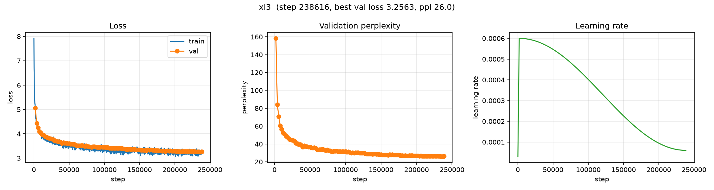

# Chinchilla experiment: `xl3` (FineWeb-Edu, vocab 16k)

**Experiment:** `chinchilla/xl3`
**Date:** 2026-10-15
**Status:** complete (238,616 steps · 1.95B tokens · 3.41 h on a rented GPU)

## Purpose

The first **compute-optimal** ("Chinchilla") run, and the first run of the project
at the ~2B-token scale.

Every earlier experiment moved **one axis at a time** — model size, then data, then
compute — and each flattened out on its own (see [§3–6](../../../EXPERIMENTS.md)).
The natural next step is to scale **model, data and compute together** to the
balance Chinchilla prescribes: **~20 tokens per parameter**.

This run also validates the full scaled pipeline end to end: a ~3.3B-token corpus
prepared from FineWeb-Edu, a 16k tokenizer, and a 238k-step training run with
checkpoint/resume on rented hardware.

## Setup

| | |
|---|---|
| Model | `xl3` — GPT, 12L / 12H / 768d, **97,737,216 params** (vocab 16,384, tied embeddings) |
| Corpus | FineWeb-Edu (`HuggingFaceFW/fineweb-edu`, `sample-10BT`), 3M documents |
| Tokenizer | byte-level BPE, **vocab 16,384** (fertility 0.2318 tokens/byte ≈ 4.31 chars/token) |
| Data budget | `D = 1,954,744,320` tokens = **k = 20** tokens/param |
| Compute | `C = 6·N·D ≈ 1.146e18` FLOPs; **238,616 steps**; batch 64; context 128 |
| Optimizer | AdamW, `lr = 6e-4`, warmup 2,000 → cosine to 0.1×, `grad_clip = 1.0` |
| Precision | AMP (`auto`) |
| Seed | 0 |

`max_steps` is **derived**, not rounded:

```
steps = D / (batch · context) = 1,954,744,320 / (64 · 128) = 238,616
```

### Why `k = 20`?

Hoffmann et al. (2022) found that for a fixed compute budget, model size and
training tokens should grow in **equal proportion — about 20 tokens per
parameter**. A 97.7M-parameter model therefore wants ~1.95B tokens. Training it on
1.95B tokens is (by that recipe) compute-optimal; training it on much less would
leave it undertrained, much more would be past the optimum.

## Results

| | |
|---|---|
| **Best val loss** | **3.2563** (step 236,000) |
| Best ppl | 25.95 |
| **Best bits/byte** | **1.089** |
| Final val loss | 3.2676 (step 238,616) |
| Final val ppl | 26.25 |
| Final train loss | ~3.31 (single noisy batch; ~3.24 smoothed) |
| Tokens seen | 1,954,611,200 (1.0 epoch of the training slice) |
| Wall-clock | 12,291 s = **3.41 h** |
| Throughput | ~113,700 tokens/s |
| Instability? | none |

The validation curve is smooth and essentially monotone; the last tick
(3.2563 → 3.2676) is within eval noise (20 batches).

### Validation loss over training (all 120 evals, every 2,000 steps)

```
5.064 4.435 4.259 4.101 4.038 3.966 3.935 3.894 3.865 3.834
3.807 3.792 3.787 3.760 3.712 3.703 3.678 3.680 3.651 3.599
3.637 3.620 3.611 3.600 3.602 3.582 3.576 3.582 3.563 3.525
3.512 3.518 3.517 3.530 3.509 3.485 3.515 3.485 3.475 3.458
3.450 3.466 3.470 3.463 3.442 3.452 3.451 3.460 3.448 3.456
3.435 3.442 3.425 3.403 3.413 3.402 3.410 3.411 3.410 3.403
3.404 3.403 3.399 3.380 3.364 3.361 3.363 3.365 3.350 3.366
3.362 3.354 3.348 3.341 3.343 3.328 3.323 3.330 3.322 3.318
3.339 3.331 3.336 3.323 3.324 3.321 3.320 3.310 3.305 3.304
3.293 3.303 3.282 3.289 3.297 3.295 3.297 3.291 3.284 3.284
3.281 3.273 3.281 3.267 3.271 3.271 3.274 3.277 3.274 3.275
3.271 3.279 3.277 3.271 3.270 3.269 3.264 3.256 3.261 3.268
```

### Training curves



*Train/val loss, validation perplexity, and the learning-rate schedule.*

## Was the extra compute worth it?

Same **model, corpus and tokenizer** as the tokenizer-sweep `v16384` run — but
**11.9× more data and compute**:

| | `tokenizer/v16384` | **`chinchilla/xl3`** | change |
|---|---|---|---|
| Data `D` | 164M | 1.955B | 11.9× |
| Compute `C` | 9.6e16 | 1.146e18 | 11.9× |
| Steps | 20,000 | 238,616 | 11.9× |
| Best val loss | 3.462 | **3.256** | −5.9% |
| **Best bits/byte** | 1.158 | **1.089** | **−5.9%** |

**~12× the compute buys ~6% better bits/byte** — a clear, if modest, gain. This is
the same *diminishing-returns* shape seen across every earlier single-axis sweep,
but this time the model is **not undertrained**: it sits at the compute-optimal
balance, so the gain reflects what more compute *should* buy at this scale.

## Sample generations

Prompt `The history of`, `temperature = 0.8`, `top_k = 50`.

**Step 8,000 — fluent but repetitive, drifting:**

```
The history of the American colonies in America
The American colonies were the first settlers to carry, the first settlers to
leave the colony by the Indians or the second American settlers of the colonies
and the second Americans to settle in the colony. ...
```

**Step 106,000 — coherent paragraphs, encyclopedia register:**

```
The history of the nation has shown that government has been more than just a
collection of powers, it has helped shape the development of the nation. ...
Some of the most influential social movements in the country have been the
development of the Nation as a whole. ...
```

**Step 238,616 — grammatical, long-range structure, factually incoherent:**

```
The history of the United States in its place of slavery is an interesting one.
There exists many such issues in this country, and it is a major consideration
of the war. ... it is a country which, if any man wants to be free, should be
free from slavery ... without the benefit of the United States, which is the
United States, which is not the United States but it is the Union. ...
```

The progression is the familiar one: noise → local fluency → long-range syntax and
paragraph structure. The **form** of an essay is there; the **content** is still
hallucinated ("the United States ... was at war with the United States").

## Observations

1. **Compute-optimal training works.** The model trains stably for 238k steps and
   reaches val loss 3.256 / **1.089 bits/byte** — the best result in the project so
   far, on the largest budget so far.
2. **More compute helps, but with diminishing returns.** ~12× the compute (vs the
   164M-token 16k run) yields ~6% better bits/byte. Scaling the single axes further
   alone would be wasteful; the balance is what matters.
3. **No instability.** The smooth, monotone curve at 97.7M params / 1.95B tokens
   reinforces that the earlier `xl3` spike was corpus/stochastic, not architectural.
4. **Scale ≠ knowledge (yet).** Samples are structurally excellent and factually
   empty — expected at ~98M params. Real knowledge/instruction behaviour is a job
   for the fine-tuning/alignment stages, not raw pre-training at this size.

## Caveats

- **Single seed; no error bars.** The −5.9% vs the 164M-token run is well outside
  eval noise, but there are no repeated runs.
- **Sampling is with replacement.** The bounded `ChunkedRandomSampler` (added to
  avoid materialising a full ~2B-element permutation) draws random windows *with*
  replacement. Over the ~1.955B windows processed, the expected number of **unique**
  windows is ≈ 63% (~1.24B). The standard `D` (tokens *processed*) — and therefore
  the k = 20 compute-optimality — is unchanged, but the effective unique data is
  smaller than the nominal budget.
- **Bits/byte uses the tokenizer-sweep fertility** (0.2318 tokens/byte). Same
  corpus and tokenizer, so it is directly comparable to the sweep's 16k row.
- The prepared corpus held 3.29B tokens, but the run used the first 1.955B
  (`max_train_tokens`); the remainder was unused.

## Next steps

1. **Scale up, still compute-optimal** — a larger model (e.g. ~350M) at ~20
   tokens/param (~7B tokens) on rented GPUs.
2. **Use this checkpoint as the base** for supervised fine-tuning / alignment.
3. Consider whether sampling *without* replacement (shuffle shards / blocks) is
   worth it to use every window once per epoch.

## Artifacts

```
artifacts/runs/chinchilla/xl3/
├── best.pt                  # best val-loss checkpoint (step 236,000)
├── latest.pt                # final checkpoint (step 238,616)
└── events.out.tfevents.*    # TensorBoard logs (2 files: original run + resume)
```

The run was executed in two sessions (interrupted and resumed from `latest.pt`);
TensorBoard merges both event files into one continuous curve.

## Reproduction

```bash
scripts/run_chinchilla.sh    # prepare (skip if present) + train

# or manually:
uv run python scripts/prepare_data.py --config configs/experiments/fineweb_edu/chinchilla/xl3.yaml
uv run python scripts/train.py        --config configs/experiments/fineweb_edu/chinchilla/xl3.yaml
uv run python scripts/plot_curves.py  --run-dir artifacts/runs/chinchilla/xl3 \
    --out docs/fineweb_edu/chinchilla/xl3_curves.png
```

Config: [`configs/experiments/fineweb_edu/chinchilla/xl3.yaml`](../../../configs/experiments/fineweb_edu/chinchilla/xl3.yaml)
