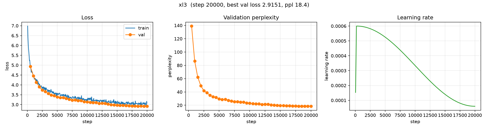
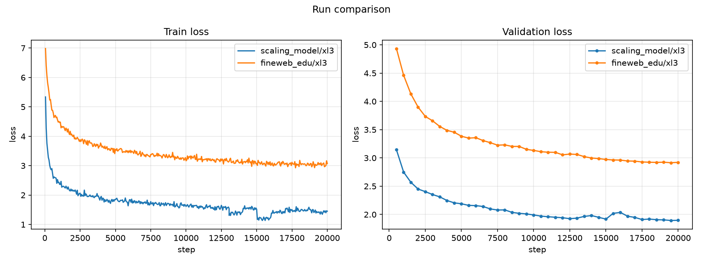

# Corpus swap: TinyStories → FineWeb-Edu (`xl3`)

**Experiment:** `fineweb_edu/xl3`
**Date:** 2026-10-13
**Status:** complete (20,000 steps)

## Purpose

The first step of the "real knowledge" line. **One change only**: swap the corpus
from TinyStories to FineWeb-Edu, keeping the model, tokenizer *size*, data budget
and compute identical. This isolates the effect of the **data**.

## Setup

| | |
|---|---|
| Model | `xl3` — GPT, 12L/12H/768d, **88,300,032 params** (identical to the TinyStories `xl3`) |
| Corpus | **FineWeb-Edu** (`HuggingFaceFW/fineweb-edu`, `sample-10BT`) |
| Tokenizer | byte-level BPE, **vocab 4096** (retrained on FineWeb-Edu — same size, new merges) |
| Data budget | `D = 164M` tokens (≈ 1 epoch) |
| Compute | 20,000 steps; batch 64; context 128 |
| Optimizer | AdamW, `lr = 6e-4`, warmup 200 + cosine to 0.1×, `grad_clip = 1.0` |
| Precision | AMP (`auto`) |
| Seed | 0 |

The only difference from `scaling_model/xl3` is the corpus.

## Results (step 20,000)

| | FineWeb-Edu | TinyStories (reference) |
|---|---|---|
| Best val loss | 2.915 | 1.894 |
| Best ppl | 18.45 | 6.65 |
| Final train loss | 3.072 | 1.452 |
| Instability? | **none** | +0.10 val spike @ 15500 |

> **Cross-corpus loss is not comparable.** FineWeb-Edu is real, diverse web prose
> with far higher intrinsic entropy than TinyStories' simple children's stories, so
> a higher loss is *expected* — it is not a regression.

### Validation loss over training (all 40 evals)

```
4.935 4.460 4.132 3.899 3.734 3.657 3.556 3.488 3.454 3.384
3.351 3.358 3.307 3.270 3.226 3.231 3.203 3.203 3.151 3.133
3.110 3.101 3.098 3.055 3.068 3.061 3.023 2.998 2.988 2.973
2.964 2.962 2.946 2.943 2.929 2.924 2.921 2.925 2.915 2.922
```

Smooth and essentially monotone — best val **2.915 @ 19500**.

### Training curves



*This run (train/val loss, perplexity, LR).*



*Train (left) and validation (right) loss: TinyStories `xl3` vs FineWeb-Edu `xl3`.
Note the TinyStories spike around step 15500, absent here.*

## Sample generations

Prompt: `The history of`, `temperature = 0.8`, `top_k = 50`.

**Step 500 — noisy (corrupted-bibliography register):**

```
The history of the Barst, and Laon, Petan Titin, Solf, M,
Clov, F, H. A. E.S., B. S. S., M, D. (1973).
Wast Word, M. O. V. (20.10.
...
```

**Step 20,000 — encyclopedic register, factually wrong:**

```
The history of the Southern Ocean is a rough and unstructured portrayal of the
western coastal towns, especially the southern coasts of the United States and
Canada. The Ocean has been the northeastern part of the world for centuries.
The Ocean is the largest continent in the world and the Middle East, the Middle
East, and China. ...
```

By step 20k the model produces fluent, encyclopedic-style sentences with real
vocabulary and correct syntax — but the facts are wrong ("the Southern Ocean is
the largest continent"). It has learned the **form** of knowledge, not the content.

## Observations

1. **The model trains on real text.** Samples shift from noise (step 500) to
   fluent, encyclopedia-flavoured prose (step 20k): real vocabulary, correct
   grammar, the right *register* — but hallucinated facts. Expected at 88M params
   with only 164M tokens (~1 epoch).
2. **The `xl3` instability did not reappear.** On TinyStories, `xl3` spiked in
   validation loss around steps 13k–16k; on FineWeb-Edu the curve is smooth and
   monotone. This suggests that instability was **data-related (or stochastic)**,
   not an inherent property of the 88M model.
3. **Higher loss ≠ worse model.** The loss is higher simply because the corpus is
   harder; the *behaviour* (register, fluency) is qualitatively richer than
   TinyStories.

## Caveats

- Single seed; no error bars.
- Cross-corpus loss is not comparable.
- Vocab 4096 is small for web text (high fertility) — a larger vocab is the next
  experiment.

## Next steps

1. **Tokenizer** — a larger vocab (8k / 16k / 32k), settled *before* scaling.
2. **Data + compute** — more data **and** steps together (the Chinchilla way).
3. **Model** — larger, once the tokenizer and data are fixed.

## Artifacts

```
artifacts/runs/fineweb_edu/xl3/
├── best.pt                  # best validation loss checkpoint (step 19500)
├── latest.pt                # last checkpoint (step 20000)
└── events.out.tfevents.*    # TensorBoard logs
```

## Reproduction

```bash
uv run python scripts/prepare_data.py --config configs/experiments/fineweb_edu/xl3.yaml
uv run python scripts/train.py     --config configs/experiments/fineweb_edu/xl3.yaml
uv run python scripts/plot_curves.py --run-dir \
  artifacts/runs/scaling_model/xl3 artifacts/runs/fineweb_edu/xl3 \
  --out docs/fineweb_edu/corpus_comparison.png
```

Config: [`configs/experiments/fineweb_edu/xl3.yaml`](../../../configs/experiments/fineweb_edu/xl3.yaml)
