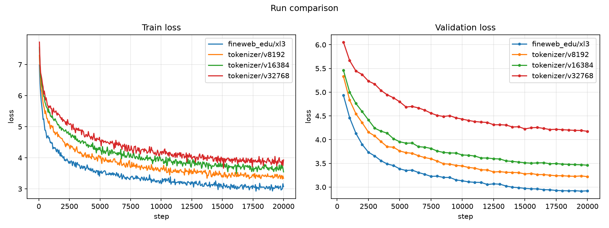
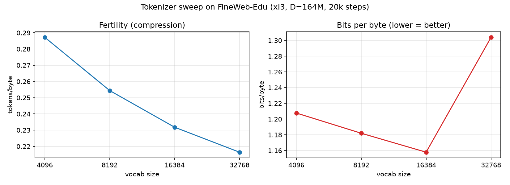

# Tokenizer sweep: vocab size (FineWeb-Edu)

**Experiment:** `tokenizer/{v8192,v16384,v32768}` + baseline `fineweb_edu/xl3` (vocab 4096)
**Date:** 2026-10-14
**Status:** complete (4 × 20,000 steps)

## Purpose

Choose the tokenizer **vocab size** before scaling up. **One change**: the vocab —
same corpus (FineWeb-Edu), same model architecture (`xl3`), same data budget
(`D = 164M`) and compute (20k steps).

## The metric: bits-per-byte

A raw per-token loss is **not** comparable across vocab sizes: a bigger vocab packs
more text (and more information) into each token, so its per-token loss is
*naturally higher*. The fair, tokenizer-independent metric is **bits per byte**:

```
bits/byte = loss_per_token · (tokens/byte) / ln 2
```

where `tokens/byte` is the tokenizer's **fertility** on the val text.

## Setup

| | |
|---|---|
| Corpus | FineWeb-Edu (`HuggingFaceFW/fineweb-edu`, `sample-10BT`) |
| Model | `xl3` (12L/12H/768d) — same architecture for all vocabs |
| Data budget | `D = 164M` tokens (≈ 1 epoch) |
| Compute | 20,000 steps; batch 64; context 128; AMP |
| Seed | 0 |

## Results (step 20,000)

| Vocab | Params | tokens/byte | chars/token | Best val loss | Best ppl | **bits/byte** |
|---|---|---|---|---|---|---|
| 4096 (baseline) | 88.3M | 0.2872 | 3.48 | 2.915 | 18.45 | 1.208 |
| 8192 | 91.4M | 0.2544 | 3.93 | 3.220 | 25.03 | 1.182 |
| **16384** | 97.7M | 0.2318 | 4.31 | 3.462 | 31.87 | **1.158** |
| 32768 | 110.3M | 0.2164 | 4.62 | 4.176 | 65.09 | 1.304 |

### Figures



*Per-token train/val loss for each vocab (not comparable across vocabs — shown for
the dynamics).*



*Left: fertility (tokens/byte). Right: bits/byte — the fair comparison.*

## Observations

1. **Per-token loss rises with vocab — expected, not a regression.** Bigger tokens
   carry more information, so per-token loss is naturally higher. Only bits/byte
   is comparable.
2. **Bits-per-byte is U-shaped, minimised at ~16k.** It falls 1.208 → 1.182 →
   **1.158** (16k), then *rises* to **1.304** at 32k.
3. **32k is past the knee.** Fertility still improves (0.232 → 0.216 tokens/byte,
   only −6.6%) but the per-token loss jumps (+21%), so bits/byte gets worse.
4. **Sweet spot ≈ 8k–16k** for this model/budget — that's the vocab to carry into
   the scaled runs.

## Caveats

- **Single seed; no error bars.** Treat the ~2% differences (4k ↔ 16k) as
  suggestive rather than conclusive.
- **The embedding grows with vocab** (88M → 110M params), so this is not *purely*
  the tokenizer: the 32k model is also more undertrained at the same budget, which
  likely contributes to its worse bits/byte.
- The val set is tokenized differently per vocab (its tail is cut at a slightly
  different point), so fertility is measured on a near-identical — not identical —
  text.

## Conclusion

Adopt a **vocab of ~16k** for the next steps. It gives the best bits-per-byte; 32k
buys more compression but costs too many parameters for the gain.

## Next steps

1. **More data + steps** (together, the Chinchilla way) with the ~16k tokenizer.
2. Then a **larger model**.

## Artifacts

```
artifacts/runs/tokenizer/{v8192,v16384,v32768}/   # + fineweb_edu/xl3 (vocab 4096)
├── best.pt
├── latest.pt
└── events.out.tfevents.*
```

## Reproduction

```bash
scripts/run_tokenizer_sweep.sh    # prepare (if needed) + train v8192, v16384, v32768
```

Configs: [`configs/experiments/fineweb_edu/tokenizer/`](../../../configs/experiments/fineweb_edu/tokenizer/)
