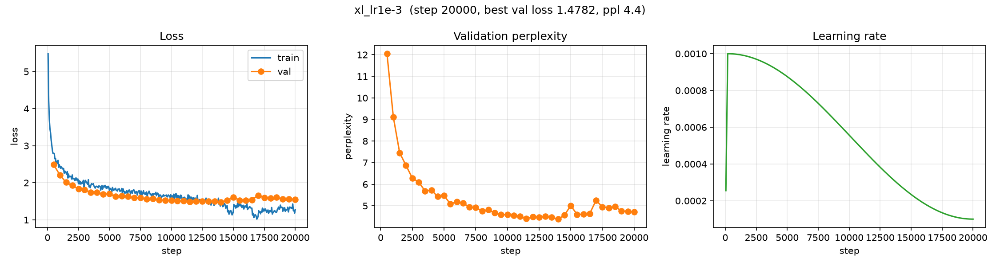

# Scaling: GPT Model-Size Sweep

**Experiment:** `scaling` (runs `scaling/{s,m,l,xl,xl_lr1e-3}`)
**Date:** 2026-10-10
**Status:** complete (5 × 20,000 steps)

## Purpose

The first scaling experiment: how does GPT validation loss change with **model
size** when data, tokenizer, context and the training budget are held fixed? It
also served as the testbed for the new throughput / compute accounting.

## Setup

| | |
|---|---|
| Corpus | TinyStories (~22M tokens, 100k stories) |
| Tokenizer | byte-level BPE, `vocab_size = 4096` |
| Context | 128 tokens; batch 64 (8,192 tokens/step) |
| Budget | 20,000 steps ≈ 164M tokens ≈ 7.4 epochs, identical for all sizes |
| Optimizer | AdamW, `lr = 3e-3`, warmup 200 + cosine to 0.1×, `grad_clip = 1.0` |
| Seed | 0 |
| Sampling / early stopping | disabled (fixed budget, no generation overhead) |

| Run | `n_layer` | `n_head` | `n_embd` | Params |
|---|---|---|---|---|
| `s` | 3 | 6 | 192 | 2,145,984 |
| `m` | 4 | 8 | 256 | 4,240,896 |
| `l` | 6 | 8 | 384 | 12,269,568 |
| `xl` | 8 | 8 | 512 | 27,382,784 |

The `xl` run **diverged** at `lr = 3e-3` (see below), so a follow-up run
`xl_lr1e-3` repeated the exact same XL configuration with **only the learning
rate lowered to `1e-3`**.

## Results (step 20,000)

| Run | Params | LR | Val loss | Val ppl | Best val loss | Train loss |
|---|---|---|---|---|---|---|
| `s` | 2.15M | 3e-3 | 1.712 | 5.54 | 1.699 | 1.845 |
| `m` | 4.24M | 3e-3 | 1.570 | 4.80 | 1.570 | 1.731 |
| `l` | 12.27M | 3e-3 | 1.547 | 4.70 | 1.547 | 1.627 |
| `xl` | 27.38M | 3e-3 | 2.962 | 19.34 | 2.742 (@ step 500) | 3.171 |
| `xl_lr1e-3` | 27.38M | **1e-3** | 1.553 | 4.72 | **1.478** (@ step 14000) | 1.269 |

### Validation loss over training

| Step | 500 | 2000 | 4000 | 6000 | 8000 | 10000 | 14000 | 18000 | 20000 |
|---|---|---|---|---|---|---|---|---|---|
| `s` | 2.713 | 2.134 | 2.015 | 1.903 | 1.829 | 1.789 | 1.743 | 1.721 | 1.712 |
| `m` | 2.595 | 2.071 | 1.864 | 1.800 | 1.735 | 1.706 | 1.621 | 1.588 | 1.570 |
| `l` | 2.554 | 2.032 | 1.832 | 1.712 | 1.666 | 1.610 | 1.560 | 1.559 | 1.547 |
| `xl` | 2.742 | 3.548 | 3.692 | 3.512 | 3.394 | 3.338 | 3.181 | 2.997 | 2.962 |
| `xl_lr1e-3` | 2.489 | 1.927 | 1.745 | 1.645 | 1.558 | 1.523 | 1.478 | 1.590 | 1.553 |

### Training curves

Each panel: train/val loss (left), validation perplexity (middle), learning-rate
schedule (right). Generated with [`scripts/plot_curves.py`](../../scripts/plot_curves.py).

**`s` — 2.15M params**


**`m` — 4.24M params**


**`l` — 12.27M params**


**`xl` — 27.38M params, `lr = 3e-3`** (note the divergence around steps 500–2000)


**`xl_lr1e-3` — 27.38M params, `lr = 1e-3`** (same model, lower LR — stable)



## Observations

- **Validation loss improves monotonically with size** once the LR is sensible:
  best val loss 1.699 (`s`) → 1.570 (`m`) → 1.547 (`l`) → **1.478** (`xl_lr1e-3`).
  The gains shrink fast (0.13, 0.02, 0.07 nats), the signature of a
  **data-limited** regime: every size sees the same ~22M unique tokens (~7.4
  epochs).
- **`xl` at `lr = 3e-3` diverges.** It starts *best* of all (val 2.742 at step
  500), then blows up between steps 500–2000 (train 2.97 → 3.86, val 2.74 →
  3.76) and only slowly recovers as the LR decays — ending at val 2.962, worse
  than every smaller model. Weights stay finite (no NaNs, max |w| ≈ 6.6): a
  **training instability, not a capacity limit**.
- **Lowering the LR fixes it.** `xl_lr1e-3` (same 27M model, only `lr = 1e-3`)
  trains stably, is the best run overall (best val 1.478, ppl 4.38), and even
  learns fastest early. This confirms the blow-up was an **optimization** problem:
  `lr = 3e-3` was simply too high for the largest model.
- The second half of `xl_lr1e-3` is noisier (train loss oscillates ~1.1–1.5, val
  spikes at steps 15000/17000); this looks like minibatch/eval noise plus mild
  overfitting (train ~1.27 vs val ~1.5) rather than a new instability.

## Caveats

- Single seed; no error bars.
- **Fixed LR across the main sweep.** Larger models need a lower LR — the `xl`
  divergence and its `1e-3` fix are direct evidence. The original sweep therefore
  confounds size with LR; only `xl_lr1e-3` isolates the LR change.
- **Fixed data/tokenizer.** The tokenizer is trained on the documents, so scaling
  data would retrain it and change the vocab — a separate experiment.

## Next steps

- ~~Re-run `xl` with a lower peak LR~~ **Done** — `xl_lr1e-3` (1e-3) trains stably
  and is the best run.
- **Scale data** (more TinyStories) to test whether the flattening trend is
  data-limited. This is the most likely next bottleneck.
- Optionally sweep the LR for the larger models (e.g. 1.5e-3 vs 1e-3) to find the
  best value rather than just a stable one.

## Artifacts

```
artifacts/runs/scaling/{s,m,l,xl,xl_lr1e-3}/
├── best.pt                  # best validation loss checkpoint
├── latest.pt                # last checkpoint (step 20000)
└── events.out.tfevents.*    # TensorBoard logs (scalars, config, throughput, compute)
```

## Reproduction

```bash
scripts/run_scaling.sh            # trains s, m, l, xl sequentially
uv run python scripts/train.py --config configs/experiments/scaling/xl_lr1e-3.yaml
uv run tensorboard --logdir artifacts/runs
```

Configs: [`configs/experiments/scaling/`](../../configs/experiments/scaling/)
