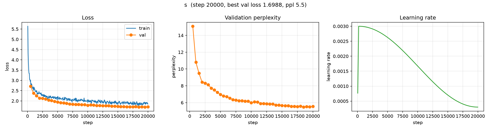
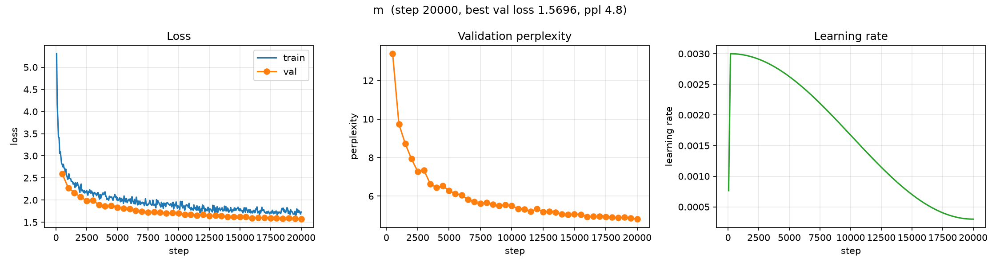
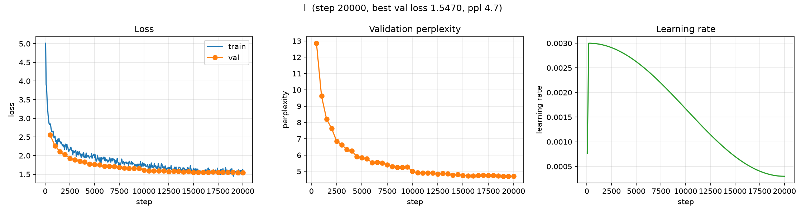
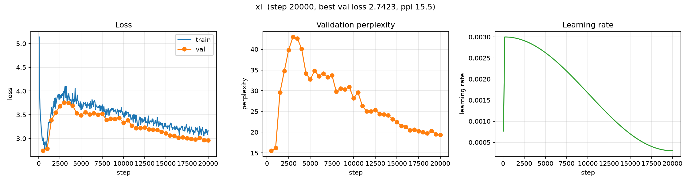

# Scaling: GPT Model-Size Sweep

**Experiment:** `scaling` (runs `scaling/{s,m,l,xl}`)
**Date:** 2026-10-10
**Status:** complete (4 × 20,000 steps)

## Purpose

The first scaling experiment: how does GPT validation loss change with **model
size** when data, tokenizer, context and the training budget are held fixed? It
also served as the testbed for the new throughput / compute accounting.

## Setup

| | |
|---|---|
| Corpus | TinyStories (~22M tokens, 100k stories) |
| Tokenizer | byte-level BPE, `vocab_size = 4096` |
| Context | 128 tokens; batch 64 (8,192 tokens/step) |
| Budget | 20,000 steps ≈ 164M tokens ≈ 7.4 epochs, identical for all sizes |
| Optimizer | AdamW, `lr = 3e-3`, warmup 200 + cosine to 0.1×, `grad_clip = 1.0` |
| Seed | 0 |
| Sampling / early stopping | disabled (fixed budget, no generation overhead) |

| Run | `n_layer` | `n_head` | `n_embd` | Params |
|---|---|---|---|---|
| `s` | 3 | 6 | 192 | 2,145,984 |
| `m` | 4 | 8 | 256 | 4,240,896 |
| `l` | 6 | 8 | 384 | 12,269,568 |
| `xl` | 8 | 8 | 512 | 27,382,784 |

## Results (step 20,000)

| Run | Params | Val loss | Val ppl | Best val loss | Train loss |
|---|---|---|---|---|---|
| `s` | 2.15M | 1.712 | 5.54 | 1.699 | 1.845 |
| `m` | 4.24M | 1.570 | 4.80 | 1.570 | 1.731 |
| `l` | 12.27M | 1.547 | 4.70 | 1.547 | 1.627 |
| `xl` | 27.38M | 2.962 | 19.34 | 2.742 (@ step 500) | 3.171 |

### Validation loss over training

| Step | 500 | 2000 | 4000 | 6000 | 8000 | 10000 | 14000 | 18000 | 20000 |
|---|---|---|---|---|---|---|---|---|---|
| `s` | 2.713 | 2.134 | 2.015 | 1.903 | 1.829 | 1.789 | 1.743 | 1.721 | 1.712 |
| `m` | 2.595 | 2.071 | 1.864 | 1.800 | 1.735 | 1.706 | 1.621 | 1.588 | 1.570 |
| `l` | 2.554 | 2.032 | 1.832 | 1.712 | 1.666 | 1.610 | 1.560 | 1.559 | 1.547 |
| `xl` | 2.742 | 3.548 | 3.692 | 3.512 | 3.394 | 3.338 | 3.181 | 2.997 | 2.962 |

### Training curves

Each panel: train/val loss (left), validation perplexity (middle), learning-rate
schedule (right). Generated with [`scripts/plot_curves.py`](../../scripts/plot_curves.py).

**`s` — 2.15M params**



**`m` — 4.24M params**



**`l` — 12.27M params**



**`xl` — 27.38M params** (note the divergence around steps 500–2000)



## Observations

- **`s → m → l` improves monotonically** with size (val loss 1.712 → 1.570 →
  1.547), as expected. The gains shrink fast (0.142 then 0.023 nats), a sign the
  runs are becoming **data-limited**: every size sees the same ~22M unique tokens
  (~7.4 epochs).
- **`xl` diverges.** It starts *best* of all (val 2.742 at step 500), then blows
  up between steps 500–2000 (train 2.97 → 3.86, val 2.74 → 3.76) and only slowly
  recovers as the LR decays — ending at val 2.962, worse than every smaller
  model. Weights stay finite (no NaNs, max |w| ≈ 6.6), so this is a **training
  instability, not a capacity limit**.
- The blow-up coincides with the LR reaching its peak (warmup ends at step 200),
  so the most likely cause is that **`lr = 3e-3` is too high for the 27M model**;
  the smaller models tolerate it fine.

## Caveats

- Single seed; no error bars.
- **Fixed LR across sizes.** Larger models often need a lower LR — the `xl`
  result is direct evidence of this, so the sweep confounds size with LR.
- **Fixed data/tokenizer.** The tokenizer is trained on the documents, so scaling
  data would retrain it and change the vocab — a separate experiment.

## Next steps

- Re-run `xl` with a lower peak LR (e.g. 1e-3) and/or a longer warmup, to confirm
  the instability is optimization-related rather than capacity-related.
- Then scale **data** (more TinyStories) to test whether the flattening `s → m → l`
  trend is data-limited.

## Artifacts

```
artifacts/runs/scaling/{s,m,l,xl}/
├── best.pt                  # best validation loss checkpoint
├── latest.pt                # last checkpoint (step 20000)
└── events.out.tfevents.*    # TensorBoard logs (scalars, config, throughput, compute)
```

## Reproduction

```bash
scripts/run_scaling.sh            # trains s, m, l, xl sequentially
uv run tensorboard --logdir artifacts/runs
```

Configs: [`configs/experiments/scaling/`](../../configs/experiments/scaling/)
