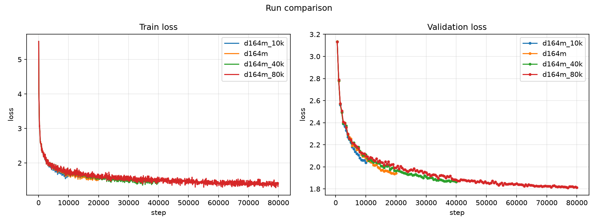

# Scaling: GPT Compute-Budget Sweep

**Experiment:** `scaling_compute` (+ the 20k reference `scaling_data/d164m`)
**Date:** 2026-10-11
**Status:** complete (4 points: 10k / 20k / 40k / 80k steps)

## Purpose

The data sweep ([`../scaling_data/data_scaling.md`](../scaling_data/data_scaling.md))
saturated around D ≈ 110M tokens at 20k steps, hinting the runs were becoming
**compute-limited**. This experiment tests the compute axis directly: fix the
model and the data budget and vary only the number of training steps.

## Setup

| | |
|---|---|
| Model | GPT **XL** (27,382,784 params), `lr = 1e-3` |
| Data | fixed `D = 164M` tokens (TinyStories pool); fixed tokenizer + val set |
| Budget | 10k / 20k / 40k / 80k steps (0.5 / 1 / 2 / 4 epochs) |
| Context / batch | 128 tokens; batch 64 (8,192 tokens/step) |
| Optimizer | AdamW, warmup 200 + cosine to 0.1×, `grad_clip = 1.0` |
| Seed | 0 |

Each run **anneals its own cosine schedule to its `max_steps`**, so every endpoint
is measured at the same LR floor (1e-4) — the fair comparison point. The 20k run
is the existing `scaling_data/d164m`.

## Results (annealed endpoint)

| Steps | Epochs | Tokens | Train loss | Val loss | Val ppl |
|---|---|---|---|---|---|
| 10k | 0.5 | 82M | 1.682 | 2.038 | 7.68 |
| 20k | 1.0 | 164M | 1.612 | **1.936** | 6.93 |
| 40k | 2.0 | 328M | 1.534 | 1.865 | 6.46 |
| 80k | 4.0 | 655M | 1.424 | **1.811** | 6.11 |

### Validation loss over training

| Step | 500 | 2000 | 5000 | 10000 | 20000 | 40000 | 80000 |
|---|---|---|---|---|---|---|---|
| 10k | 3.136 | 2.499 | 2.221 | 2.038 | — | — | — |
| 20k | 3.137 | 2.494 | 2.256 | 2.082 | 1.942 | — | — |
| 40k | 3.131 | 2.492 | 2.238 | 2.109 | 1.962 | 1.865 | — |
| 80k | 3.132 | 2.508 | 2.243 | 2.099 | 1.992 | 1.882 | 1.814 |

> The shorter-budget runs lead at a *given* step early on because their schedule
> anneals faster — another reason the **endpoints**, not intermediate steps, are
> the fair comparison.

### Training curves



*Left: train loss. Right: validation loss. One line per step budget (10k/20k/40k/80k). Generated with [`scripts/plot_curves.py`](../../scripts/plot_curves.py).*

## Observations

1. **More compute → better, monotonically.** Best val loss falls 2.038 → 1.936 →
   1.865 → 1.811 (ppl 7.68 → 6.11) as the budget grows 10k → 80k steps.
2. **Strongly diminishing returns.** The gain per *doubling* of compute shrinks:
   −0.102 → −0.071 → −0.055 nats. A power-law fit gives
   **`loss ≈ 3.41 · steps^(−0.057)`** — a **10× compute increase buys only ~12%
   lower loss**. That is the expected scaling-law behaviour (loss is a power law
   in compute with a small exponent), not a hard wall.
3. **So the "plateau" is soft.** 40k and 80k look close (1.865 vs 1.811) precisely
   because the exponent is small — but the trend is real and consistent.
4. **No overfitting here.** At D=164M even 4 epochs (80k steps) keeps improving,
   unlike `d22m` (7.4 epochs on 22M tokens), which overfit. More data pushes the
   overfitting point further out.

## The three axes so far

| Axis | Range | Result |
|---|---|---|
| Model size (`scaling`) | 2.1M → 27.4M params | monotone, flattening |
| Data (`scaling_data`) | 22M → 164M tokens | monotone, saturates ≈ 110M |
| **Compute (`scaling_compute`)** | 82M → 655M tokens | monotone, **power law α ≈ 0.06** |

All three show diminishing returns — the classic scaling picture.

## Caveats

- Single seed; no error bars.
- Fixed model and data; the compute-optimal **balance** (Chinchilla) is not swept
  directly — that needs the D × compute grid.
- Warmup fixed at 200 steps for every budget (a larger fraction of the 10k run).

## Next steps

- **D × compute grid** (e.g. D ∈ {55M, 110M, 164M} × steps ∈ {10k, 20k, 40k}) to
  fit `loss(D, C)` and locate the compute-optimal data/compute ratio.
- Or scale the **model** at the now-adequate data budget.

## Artifacts

```
artifacts/runs/scaling_compute/{d164m_10k,d164m_40k,d164m_80k}/   # + scaling_data/d164m (20k)
├── best.pt                  # best validation loss checkpoint
├── latest.pt                # last checkpoint
└── events.out.tfevents.*    # TensorBoard logs
```

## Reproduction

```bash
scripts/run_scaling_compute.sh    # trains 10k, 40k, 80k (20k = scaling_data/d164m)
uv run python scripts/plot_curves.py --run-dir \
  artifacts/runs/scaling_compute/d164m_10k artifacts/runs/scaling_data/d164m \
  artifacts/runs/scaling_compute/d164m_40k artifacts/runs/scaling_compute/d164m_80k \
  --out docs/scaling_compute/compute_curves.png
```

Configs: [`configs/experiments/scaling_compute/`](../../configs/experiments/scaling_compute/)
