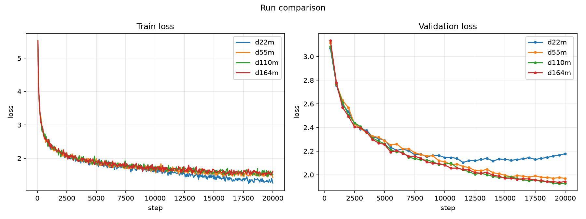

# Scaling: GPT Data-Budget Sweep

**Experiment:** `scaling_data` (runs `scaling_data/{d22m,d55m,d110m,d164m}`)
**Date:** 2026-10-11
**Status:** complete (4 × 20,000 steps)

## Purpose

The model-size sweep ([`../scaling/model_size_sweep.md`](../scaling/model_size_sweep.md))
flattened as models grew, suggesting the runs were **data-limited**: every size
saw the same ~22M unique tokens (~7.4 epochs). This experiment tests that
directly by fixing the model and the compute and varying only the **unique
training-data budget `D`**.

## Setup

| | |
|---|---|
| Model | GPT **XL** (27,382,784 params), `lr = 1e-3` (the stable config from the size sweep) |
| Budget | 20,000 steps ≈ 164M tokens, identical for every run |
| Context / batch | 128 tokens; batch 64 (8,192 tokens/step) |
| Optimizer | AdamW, warmup 200 + cosine to 0.1×, `grad_clip = 1.0` |
| Data | TinyStories, one fixed pool of 800k stories |
| Tokenizer / val | **fixed**: trained once on the pool; a single fixed validation set |
| Seed | 0 |

Each run trains on a **prefix** of the same token stream, so the tokenizer and
validation set are identical across runs and only `D` changes:

| Run | `D` (tokens) | Epochs |
|---|---|---|
| `d22m` | 22M | 7.4 |
| `d55m` | 55M | 3.0 |
| `d110m` | 110M | 1.5 |
| `d164m` | 164M | 1.0 |

## Results (step 20,000)

| Run | `D` | Epochs | Train loss | Val loss | Best val loss | Val ppl |
|---|---|---|---|---|---|---|
| `d22m` | 22M | 7.4 | **1.258** | 2.178 | 2.104 (@ 11500) | 8.20 |
| `d55m` | 55M | 3.0 | 1.420 | 1.969 | 1.969 (@ 20000) | 7.16 |
| `d110m` | 110M | 1.5 | 1.514 | 1.928 | **1.925** (@ 19500) | **6.86** |
| `d164m` | 164M | 1.0 | 1.612 | 1.942 | 1.936 (@ 19500) | 6.93 |

### Validation loss over training

| Step | 500 | 2000 | 4000 | 6000 | 8000 | 10000 | 12000 | 14000 | 16000 | 18000 | 20000 |
|---|---|---|---|---|---|---|---|---|---|---|---|
| `d22m` | 3.068 | 2.534 | 2.320 | 2.206 | 2.174 | 2.145 | 2.120 | 2.116 | 2.129 | 2.139 | 2.178 |
| `d55m` | 3.116 | 2.566 | 2.325 | 2.261 | 2.171 | 2.110 | 2.061 | 2.017 | 1.993 | 1.979 | 1.969 |
| `d110m` | 3.084 | 2.506 | 2.311 | 2.193 | 2.127 | 2.090 | 2.026 | 1.986 | 1.967 | 1.943 | 1.928 |
| `d164m` | 3.137 | 2.494 | 2.299 | 2.204 | 2.139 | 2.082 | 2.041 | 1.997 | 1.962 | 1.951 | 1.942 |

### Training curves



*Left: train loss. Right: validation loss. One line per data budget. Generated with [`scripts/plot_curves.py`](../../scripts/plot_curves.py).*

## Observations

1. **Smaller data → lower train loss (memorization).** Final train loss rises
   monotonically with `D`: 1.258 (`d22m`) → 1.420 → 1.514 → 1.612 (`d164m`). With
   ~7.4 passes over a small stream the model can fit it far more tightly than a
   stream it sees roughly once.
2. **Larger data → lower validation loss (generalization).** Best val loss falls
   from 2.104 (`d22m`) → 1.969 → **1.925** (`d110m`): perplexity 8.20 → 6.86.
   More unique tokens → better generalization, as expected.
3. **`d22m` overfits.** Its validation loss bottoms at **2.104 (step 11500)** and
   then *rises* to 2.178 while train loss keeps falling (2.12 → 1.26) — textbook
   overfitting from re-reading the same 22M tokens.
4. **The benefit saturates around ~1.5 epochs.** `d164m` (1.0 epoch) is *not*
   better than `d110m` (1.5 epochs) — 1.936 vs 1.925, within noise. So beyond
   ~110M unique tokens, more data at this fixed compute stops helping: the run is
   becoming **compute-limited**, not data-limited.

## Caveats

- Single seed; no error bars.
- Fixed model (XL) and compute (20k steps); the data/compute-optimal trade-off
  itself is not swept.
- The pool's tokenizer and validation set differ from the earlier TinyStories
  runs, so absolute numbers aren't directly comparable across experiments.

## Next steps

- A small **compute sweep** (e.g. 20k vs 40k steps) at fixed `D` to separate the
  data-limited and compute-limited regimes — the classic Chinchilla 2-D picture.
- Or scale the **model** at the now-adequate data budget (`d110m`+) to see whether
  a larger model converts more data into lower loss.

## Artifacts

```
artifacts/runs/scaling_data/{d22m,d55m,d110m,d164m}/
├── best.pt                  # best validation loss checkpoint
├── latest.pt                # last checkpoint (step 20000)
└── events.out.tfevents.*    # TensorBoard logs
```

## Reproduction

```bash
# one-time: build the fixed pool (tokenizer + train/val)
uv run python scripts/prepare_data.py --config configs/experiments/scaling_data/pool.yaml
# the sweep
scripts/run_scaling_data.sh
# comparison plot
uv run python scripts/plot_curves.py \
  --run-dir artifacts/runs/scaling_data/{d22m,d55m,d110m,d164m} \
  --out docs/scaling_data/data_scaling_curves.png
```

Configs: [`configs/experiments/scaling_data/`](../../configs/experiments/scaling_data/)
