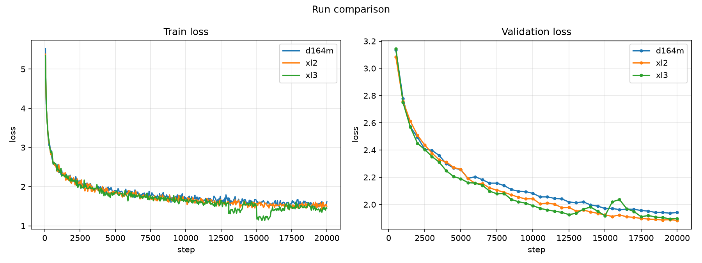

# Scaling: GPT Model-Size (larger models undertrained)

**Experiment:** `scaling_model` (runs `scaling_model/{xl2,xl3}` + reference `scaling_data/d164m`)
**Date:** 2026-10-12
**Status:** complete (3 × 20,000 steps)

## Purpose

The data sweep fixed the budget that is adequate for the **smallest** model here,
`xl` (27M) — its validation loss saturated around ~110M tokens. This experiment
then scaled the **model** up to 52M and 88M at that same fixed data/compute
budget.

By design, the larger models are therefore **undertrained**: at `D = 164M` they
see only ~3 (52M) and ~1.9 (88M) tokens per parameter, far below Chinchilla's ~20.
We knew this from the start. The question was not "which size is best" but **"does
scaling the model at a budget suited to the smallest one reveal anything?"**

## Setup

| | |
|---|---|
| Data | fixed `D = 164M` tokens (TinyStories pool) — adequate for `xl` (27M), **not** for the larger models |
| Compute | fixed 20,000 steps (≈ 1 epoch) |
| Architecture | standard GPT (pre-LN, tied embeddings, GELU 4×); `n_embd/n_layer = 64`, `head_dim = 64` |
| LR | scaled down with width (`lr ∝ 1/n_embd`) |
| Seed | 0 |

| Run | `n_layer`/`n_head`/`n_embd` | Params | LR | Tokens/param |
|---|---|---|---|---|
| `xl` (ref = `scaling_data/d164m`) | 8/8/512 | 27.4M | 1.0e-3 | ~6 |
| `xl2` | 10/10/640 | 51.9M | 8.0e-4 | ~3 |
| `xl3` | 12/12/768 | 88.3M | 6.0e-4 | ~1.9 |

## Results (step 20,000)

| Run | Params | Best val loss | Best ppl | Final val | Final train |
|---|---|---|---|---|---|
| `xl` | 27.4M | 1.936 | 6.93 | 1.942 | 1.612 |
| `xl2` | 51.9M | 1.883 | 6.57 | 1.883 | 1.502 |
| `xl3` | 88.3M | 1.894 | 6.65 | 1.897 | 1.452 |

> **Do not over-read this table.** These are **single runs with no error bars**,
> and the spread (1.883–1.942, ~0.06 nats) is within ordinary run-to-run noise. We
> cannot rank the three sizes from one seed each — and the two larger models are
> undertrained anyway.

### Training curves



*Left: train loss. Right: validation loss. One line per size (27M / 52M / 88M), 20k steps. Generated with [`scripts/plot_curves.py`](../../scripts/plot_curves.py).*

## The one clear finding: instability at the largest size

The robust, interpretable signal is that **`xl3` (88M) destabilises**. Its
validation loss dips to ~1.93 around step 12500, then **spikes to ~2.04 across
steps 13k–16k** (a **+0.10 jump at step 15500**) before recovering to ~1.89.
`xl` and `xl2` descend smoothly throughout.

- It is an **instability**, not overfitting: validation loss does not rise
  monotonically while training falls — it spikes transiently and then recovers.
- It is the **same family** as the earlier `xl@3e-3` blow-up, just much milder.
- It is **not simply "LR too high"**: `xl3`'s LR (6e-4) is already *lower* than
  `xl2`'s (8e-4). The 88M model is simply closer to the edge of stable training.

**Takeaway:** bigger models are **harder to keep stable**, and — at a budget that
suits the smallest model — they are also **undertrained**. Both point the same
way: to scale the model, you must **scale data and compute with it** *and* take
care with optimisation stability.

## Caveats

- **Single seed, no error bars** → no statistical claims; small differences are
  noise.
- The larger models are **undertrained by design** (data/compute-starved).
- Fixed width-scaled LR rule.

## Next steps

- **Scale data + compute + model together** (the ~350M build) — the only way a
  bigger model can pay off.
- Keep stability in mind (LR / warmup) as models grow.

## Artifacts

```
artifacts/runs/scaling_model/{xl2,xl3}/   # + scaling_data/d164m (xl reference)
├── best.pt                  # best validation loss checkpoint
├── latest.pt                # last checkpoint (step 20000)
└── events.out.tfevents.*    # TensorBoard logs
```

## Reproduction

```bash
scripts/run_scaling_model.sh    # trains xl2, xl3 (xl reference = scaling_data/d164m)
uv run python scripts/plot_curves.py --run-dir \
  artifacts/runs/scaling_data/d164m \
  artifacts/runs/scaling_model/xl2 artifacts/runs/scaling_model/xl3 \
  --out docs/scaling_model/model_scaling_curves.png
```

Configs: [`configs/experiments/scaling_model/`](../../configs/experiments/scaling_model/)
