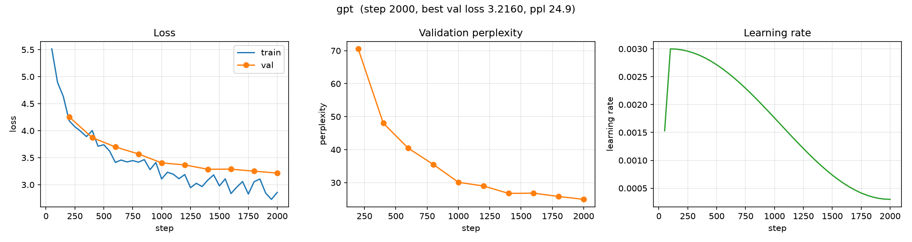

# Baseline: GPT (Decoder-only Transformer)

**Run name:** `baseline/gpt`
**Date:** 2026-10-09
**Status:** complete (2000 / 2000 steps)

## Purpose

The first transformer baseline for LLM-Lab: a small, decoder-only GPT trained
on Tiny Shakespeare. Built to validate the transformer architecture against the
existing harness and to compare with the LSTM baseline
([`lstm_baseline.md`](lstm_baseline.md)).

Notably, the GPT **outperforms the LSTM while being ~41% smaller** — see
[Comparison](#comparison-with-the-lstm-baseline).

## Setup

| | |
|---|---|
| Python | 3.13.7 |
| PyTorch | 2.14.1 |
| Device | Apple MPS (macOS arm64) |
| Corpus | Tiny Shakespeare (1,115,394 chars) |
| Tokenizer | byte-level BPE, `vocab_size = 1024` |
| Tokens | 459,913 total (413,921 train / 45,992 val) |
| Parameters | **932,608** |

### Model

- Decoder-only transformer, **pre-LN** blocks
- `n_layer = 4`, `n_head = 4`, `n_embd = 128` (`head_dim = 32`)
- Learned absolute position embeddings, `context_window = 64`
- GELU MLP with 4× expansion
- **Tied** input/output embeddings
- GPT-2-style init (`N(0, 0.02)`)

### Training

- `context_window = 64`, `batch_size = 32`
- AdamW, `learning_rate = 3e-3`, `weight_decay = 0.0`
- LR schedule: linear warmup (100 steps) + cosine decay to `min_lr_ratio = 0.1`
- `grad_clip = 1.0`, `max_steps = 2000`
- Eval every 200 steps; sample generation every eval

## Results

| Metric | Start | End (step 2000) |
|---|---|---|
| Train loss | 5.515 | 2.858 |
| Val loss | 4.256 (step 200) | **3.216** |
| Val perplexity | 70.6 | **24.93** |

Best validation loss: **3.2160** (perplexity **24.93**), reached at the final
evaluation — still improving, not plateaued.

### Validation loss over training

| Step | 200 | 400 | 600 | 800 | 1000 | 1200 | 1400 | 1600 | 1800 | 2000 |
|---|---|---|---|---|---|---|---|---|---|---|
| Val loss | 4.256 | 3.872 | 3.700 | 3.570 | 3.405 | 3.366 | 3.286 | 3.289 | 3.250 | 3.216 |
| Val ppl | 70.6 | 48.0 | 40.4 | 35.5 | 30.1 | 29.0 | 26.7 | 26.8 | 25.8 | 24.9 |

### Training curves



*Left: train/val loss. Middle: validation perplexity. Right: learning-rate schedule (warmup + cosine). Generated with [`scripts/plot_curves.py`](../../scripts/plot_curves.py).*

## Sample generations

Prompt: `ROMEO: `, `temperature = 0.8`, `top_k = 50`.

**Step 200 (early):**

```
ROMEO: Thirt'd, in the faftal'd and
And the darpuaileep
And is no pruck to make, 't
And fillow:
That I have frace,
We should
As you, hef the vandsive in the came at the baticharges,
And the little cletenion,
Becasts, to me dratands with a groany to be dright.
TINGS:

Thy, what is fillly of accay,
Eve him in the less as I have there.

PE:
Pald, as I have mious hearts's
And,
Ont, and to the world,
The stlown of Bir,
So banged, by the fully
```

**Step 2000 (final):**

```
ROMEO: He's, postey; and therefore, my lords;
And, if you wish; if they be deed to wail
Rememempt, yet he had made you,
He soony to be a subjected,
I could proceed in the king in this
By my soul babies husbanding here.

First Murderer:
Well, I have done to die: I'll go my cover,
That wish'd the fire of my dinying days
And free-growning to the wish bleedsom.

LADY  Lord:
I am in my cousin Buckingham:
Disgled you singerve your king
Than that your father was attended,
When you would have done the st
```

By step 2000 the output shows grammatical phrases, consistent speaker labels,
and blank-verse structure — qualitatively more coherent than the LSTM at the
same step.

## Comparison with the LSTM baseline

| Model | Params | Context | Val loss | Val perplexity |
|---|---|---|---|---|
| LSTM (`baseline/lstm`) | 1,577,984 | 64 | 3.233 | 25.36 |
| **GPT** (`baseline/gpt`) | **932,608** | 64 | **3.216** | **24.93** |

- The GPT reaches **lower validation loss with ~41% fewer parameters**
  (932,608 vs. 1,577,984).
- Both models were still improving at step 2000, so neither has converged.
- Qualitatively, the GPT's samples are more grammatical at the same step.

## Caveats

- **Data-limited.** Tiny Shakespeare (~0.46M tokens) is far too small for a
  meaningful architecture comparison; differences are partly noise and both
  models are compute-limited.
- **Not parameter-matched.** The GPT is *smaller* than the LSTM here, which
  makes its win notable but means this is not a controlled comparison.
- **Single seed.** One run each; no error bars.

The decisive, param-matched comparison will be run on a larger corpus
(TinyStories) in the next phase.

## Artifacts

```
artifacts/runs/baseline/gpt/
├── best.pt                  # best validation loss checkpoint
├── latest.pt                # last checkpoint (step 2000)
└── events.out.tfevents.*    # TensorBoard logs (scalars, config, samples, hparams)
```

## Reproduction

```bash
uv run python scripts/prepare_data.py --config configs/experiments/gpt_baseline.yaml
uv run python scripts/train.py --config configs/experiments/gpt_baseline.yaml
uv run tensorboard --logdir artifacts/runs
```

Config: [`configs/experiments/gpt_baseline.yaml`](../../configs/experiments/gpt_baseline.yaml)
