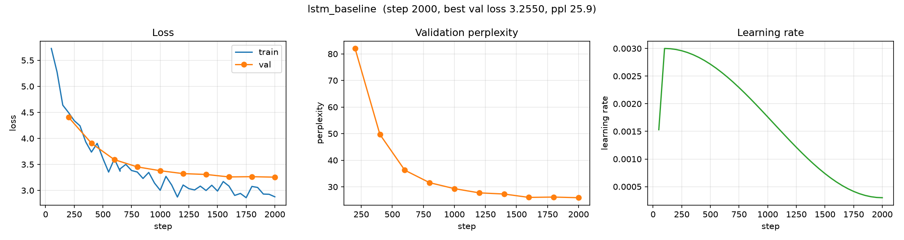

# Baseline: LSTM Language Model

**Run name:** `baseline/lstm`
**Date:** 2026-10-09
**Status:** complete (2000 / 2000 steps)

## Purpose

The first end-to-end baseline for LLM-Lab. A small, stateless LSTM language
model trained on Tiny Shakespeare. Its role is to validate the full pipeline
(data → train → eval → checkpoint → sample) and to serve as a reference point
for later architectures (in particular the decoder-only transformer).

This is a **baseline**, not a target. It exists so future changes can be
compared against a real number.

## Setup

| | |
|---|---|
| Python | 3.12.7 |
| PyTorch | 2.14.1 |
| Device | Apple MPS (macOS arm64) |
| Corpus | Tiny Shakespeare (1,115,394 chars) |
| Tokenizer | byte-level BPE, `vocab_size = 1024` |
| Tokens | 459,913 total (413,921 train / 45,992 val) |
| Parameters | 1,577,984 |

### Model

- Stateless LSTM (hidden state reset per window)
- `hidden_size = 256`, `num_layers = 2`, `dropout = 0.0`
- Embedding → LSTM → linear head to vocab

### Training

- `context_window = 64`, `batch_size = 32`
- AdamW, `learning_rate = 3e-3`, `weight_decay = 0.0`
- LR schedule: linear warmup (100 steps) + cosine decay to `min_lr_ratio = 0.1`
- `grad_clip = 1.0`, `max_steps = 2000`
- Eval every 200 steps; sample generation every eval

## Results

| Metric | Start | End (step 2000) |
|---|---|---|
| Train loss | 5.708 | 2.874 |
| Val loss | 4.399 (step 200) | **3.233** |
| Val perplexity | 81.4 | **25.4** |

Best validation loss: **3.2333** (perplexity **25.36**), reached at the final
evaluation — the model was still improving and had not yet plateaued.

### Validation loss over training

| Step | 200 | 400 | 600 | 800 | 1000 | 1200 | 1400 | 1600 | 1800 | 2000 |
|---|---|---|---|---|---|---|---|---|---|---|
| Val loss | 4.399 | 3.900 | 3.570 | 3.467 | 3.350 | 3.293 | 3.259 | 3.264 | 3.235 | 3.233 |

Train loss tail: 2.929 (1800) → 2.989 (1850) → 2.800 (1900) → 2.824 (1950) → 2.874 (2000).

### Training curves



*Left: train/val loss. Middle: validation perplexity. Right: learning-rate schedule (warmup + cosine). Generated with [`scripts/plot_curves.py`](../../scripts/plot_curves.py).*

## Sample generations

Prompt: `ROMEO: `, `temperature = 0.8`, `top_k = 50`.

**Step 200 (early) — gibberish:**

```
ROMEO: Tharch'd,
Shall a the ealt, and the lord?

SORK:

CORIOLANUS:
Thou woip, I, it is the stpreuss:
In and jated and the moes of the the vests,
That cirty me a swartmfiined,
Which
ten a mutstins, to he drapy?

First Mord:
Then, I'll my I have gried; let a bole
To cpricey of his linge, let?
Your know so eand'd to tins me!

DUKE VINCENTIO:
Pien, his faceful be, for I was her giy,
And, I be not ccvest. I'll make a lord,
Dity
```

**Step 2000 (final) — recognizable pseudo-Shakespeare:**

```
ROMEO: He were I am
They shall be spary to the volts of you,
And every man the dephese of fit and gok,
And yet he had curses for the icile, and all
As 'twere cracking in this, and infortroy,
And once more accrance of his hands.

First Gentleman:
What is the devil: I would not be divanted.

HENRY BOLINGBROKE:
Tight, we may read;
I am a weddle wale.

Second Servingman:
If I be carrusted in a mercy:
I may not sleep, and not a found of all.

MENENIUS:
Speak, messenger
```

By step 2000 the model has learned blank-verse line structure,
character-name formatting, and a real vocabulary (`devil`, `mercy`,
`sleep`, `messenger`).

> **Note — early stopping at `<|endoftext|>` was missing.** This run predates the
> `generate` fix that stops decoding at the document boundary. Tiny Shakespeare is
> effectively a single document, so the boundary token is rarely emitted and the
> samples here are largely unaffected — but generation did not honor
> `<|endoftext|>` when it did appear. Loss/perplexity are unaffected (they are
> computed on the token stream, not on generation). Runs after the fix stop
> cleanly at the boundary.

## Observations

- The pipeline works end-to-end: reproducible data prep, config-driven training,
  checkpoint/resume, TensorBoard logging (scalars, config text, sample text),
  and generation.
- Validation loss decreased monotonically and had not plateaued, so the baseline
  is **compute-limited**, not capacity-limited. More steps would likely help.
- Train loss (2.874) sits below val loss (3.233) by ~0.36 nats — a mild gap,
  expected for a model of this size on ~0.4M training tokens.

## Artifacts

```
artifacts/runs/baseline/lstm/
├── best.pt                  # best validation loss checkpoint
├── latest.pt                # last checkpoint (step 2000)
└── events.out.tfevents.*    # TensorBoard logs (scalars, config, samples, hparams)
```

Tokenizer: `artifacts/tokenizer/tiny_shakespeare_bpe.json`
Processed data: `data/processed/tiny_shakespeare/{train,val}.pt`

## Reproduction

```bash
uv run python scripts/prepare_data.py --config configs/experiments/lstm_baseline.yaml
uv run python scripts/train.py --config configs/experiments/lstm_baseline.yaml
uv run tensorboard --logdir artifacts/runs
```

Config: [`configs/experiments/lstm_baseline.yaml`](../../configs/experiments/lstm_baseline.yaml)

## Related

- [`gpt_baseline.md`](gpt_baseline.md) — the decoder-only transformer baseline,
  which reaches lower validation loss (3.216 vs. 3.233) with ~41% fewer
  parameters on the same data.
