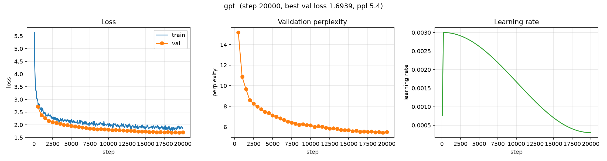

# Baseline: GPT (Decoder-only Transformer) on TinyStories

**Run name:** `tinystories/gpt`
**Date:** 2026-10-10
**Status:** complete (20000 / 20000 steps)

## Purpose

The transformer counterpart to the TinyStories LSTM
([`lstm_tinystories.md`](lstm_tinystories.md)), trained on the same data with a
near-identical parameter count. This is the **param-matched LSTM-vs-transformer
comparison** the project set out to run.

## Setup

| | |
|---|---|
| Python | 3.12.7 |
| PyTorch | 2.14.1 |
| Device | Apple MPS (macOS arm64) |
| Corpus | TinyStories (`roneneldan/TinyStories`, 100,000 stories) |
| Chars | 88,306,740 |
| Tokenizer | byte-level BPE, `vocab_size = 4096` |
| Tokens | 22,499,315 total (22,274,321 train / 224,994 val) |
| Document boundary | \<\|endoftext\|\> (id 0) between stories |
| Parameters | **2,145,984** |

### Model

- Decoder-only transformer, **pre-LN** blocks
- `n_layer = 3`, `n_head = 6`, `n_embd = 192` (`head_dim = 32`)
- Learned absolute position embeddings, `context_window = 128`
- GELU MLP with 4× expansion
- **Tied** input/output embeddings
- GPT-2-style init (`N(0, 0.02)`)

### Training

- `context_window = 128`, `batch_size = 64` (≈ 8,192 tokens/step)
- AdamW, `learning_rate = 3e-3`, `weight_decay = 0.0`
- LR schedule: linear warmup (200 steps) + cosine decay to `min_lr_ratio = 0.1`
- `grad_clip = 1.0`, `max_steps = 20000` (≈ 164M tokens ≈ 7.4 epochs)
- Eval every 500 steps; sample generation every eval

## Results

| Metric | Start | End (step 20000) |
|---|---|---|
| Train loss | 5.636 | 1.852 |
| Val loss | 2.719 (step 500) | **1.705** |
| Val perplexity | 15.2 | **5.5** |

Best validation loss: **1.6939** (perplexity **5.44**), reached at step 19500 —
the final evaluation (step 20000, loss 1.705) was marginally worse.

### Validation loss over training

| Step | 500 | 2000 | 4000 | 6000 | 8000 | 10000 | 12000 | 14000 | 16000 | 18000 | 20000 |
|---|---|---|---|---|---|---|---|---|---|---|---|
| Val loss | 2.719 | 2.152 | 2.008 | 1.920 | 1.843 | 1.815 | 1.777 | 1.742 | 1.726 | 1.715 | 1.705 |
| Val ppl | 15.2 | 8.6 | 7.4 | 6.8 | 6.3 | 6.1 | 5.9 | 5.7 | 5.6 | 5.6 | 5.5 |

### Training curves



*Left: train/val loss. Middle: validation perplexity. Right: learning-rate schedule (warmup + cosine). Generated with [`scripts/plot_curves.py`](../../scripts/plot_curves.py).*

## Sample generations

Prompt: `Once upon a time`, `temperature = 0.8`, `top_k = 50`.

**Step 500 (early):**

```
Once upon a time, there was a little girl named Lily. She was very hungry and started to eat their room. One day, she heard a strange noise. It was a big, scary noise! Lily looked out it was and started to argue.

Lily's mom told her that she was kind and told her what she was wrong. She said she had been trying. She hugged her and gave her the cots. Lily felt very happy.

After the day, Lily went to the munnamented in her bed and she knew she had been so much fun. From that day where she remembered to be kind.Once upon a time, there was a little girl named Lily. She loved to help her mommy, but she always could open the file.Once upon a time, there was a little girl named Lily. She loved to play outside her backyard. One day, Lily's mommy went to to the park, but found a big, red bird in
```

**Step 20000 (final):**

```
Once upon a time, in a small forest, there was an ordinary house. The house had a lot of leaves, and it was very special. The people in the forest loved it very much and would help it organize it in the forest.

One day, the animals came to visit them. They would talk about what the tallest thing they could find. The animals were very excited and decided to help the wealthy house. They were all very happy and grateful for the big house to help them organize their food.Once upon a time, there was a little girl named Lily. She had a big, fluffy couch in her room. One day, her mom told her she needed to go to the office to get some groceries. Lily was very sad.

But then, her mom came in and said, "Lily, we need to put the groceries away. Can you help me?" Lily said, "Sure, I can help you." Her mom put the g
```

By step 20000 the output shows grammatical sentences, consistent story
structure, and dialogue — Still no fully coherent sentences, the model mixes
scenarios and phrases together.

> **Note — early stopping at `<|endoftext|>` was missing.** This run predates the
> `generate` fix that stops decoding at the document boundary. The samples above
> were produced with the old behavior, which ignored `<|endoftext|>`; because the
> boundary token is dropped on decode, separate stories are silently concatenated
> (e.g. `...organize their food.Once upon a time...`). Loss/perplexity are
> unaffected (they are computed on the token stream, not on generation). Runs
> after the fix stop cleanly at the boundary.

## Comparison with the LSTM baseline

| Model | Params | Context | Val loss | Val perplexity |
|---|---|---|---|---|
| LSTM (`tinystories/lstm`) | 2,169,856 | 128 | 2.324 | 10.21 |
| **GPT** (`tinystories/gpt`) | **2,145,984** | 128 | **1.694** | **5.44** |

- The two models are **param-matched to within ~1%** (2,145,984 vs. 2,169,856),
  so this is a controlled architecture comparison on identical data.
- The transformer reaches **less than half the validation perplexity** of the
  LSTM (5.44 vs. 10.21).
- Both models were still improving at step 20000, so neither has converged.

## Caveats

- **Single seed.** One run each; no error bars.
- **Pre-fix samples.** Both TinyStories runs predate the `<|endoftext|>` stop fix
  (see the note above), so the sample text concatenates stories at the boundary.

## Artifacts

```
artifacts/runs/tinystories/gpt/
├── best.pt                  # best validation loss checkpoint (step 19500)
├── latest.pt                # last checkpoint (step 20000)
└── events.out.tfevents.*    # TensorBoard logs (scalars, config, samples, hparams)
```

Tokenizer: `artifacts/tokenizer/tinystories_bpe.json`
Processed data: `data/processed/tinystories/{train,val}.pt`

## Reproduction

```bash
uv run python scripts/prepare_data.py --config configs/experiments/gpt_tinystories.yaml
uv run python scripts/train.py --config configs/experiments/gpt_tinystories.yaml
uv run tensorboard --logdir artifacts/runs
```

Config: [`configs/experiments/gpt_tinystories.yaml`](../../configs/experiments/gpt_tinystories.yaml)

## Related

- [`lstm_tinystories.md`](lstm_tinystories.md) — the param-matched LSTM baseline.
- [`../shakespeare/`](../shakespeare/) — the earlier, much smaller-corpus
  baselines.
