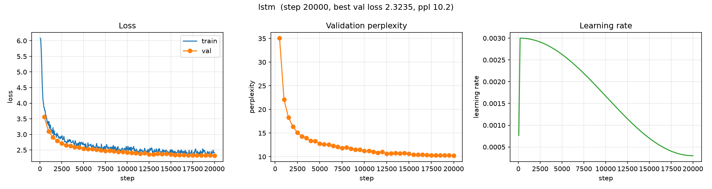

# Baseline: LSTM on TinyStories

**Run name:** `tinystories/lstm`
**Date:** 2026-10-09
**Status:** complete (20000 / 20000 steps)

## Purpose

The LSTM reference point on a **larger, multi-document corpus**. It validates
the scaled data pipeline (document streaming, `<|endoftext|>` boundaries,
larger-vocab tokenizer) and anchors the param-matched comparison against the
transformer ([`gpt_tinystories.md`](gpt_tinystories.md)).

Unlike the Tiny Shakespeare runs, this one has enough data (~22M tokens) to
leave the data-starved regime.

## Setup

| | |
|---|---|
| Python | 3.12.7 |
| PyTorch | 2.14.1 |
| Device | Apple MPS (macOS arm64) |
| Corpus | TinyStories (`roneneldan/TinyStories`, 100,000 stories) |
| Chars | 88,306,740 |
| Tokenizer | byte-level BPE, `vocab_size = 4096` |
| Tokens | 22,499,315 total (22,274,321 train / 224,994 val) |
| Document boundary | \<\|endoftext\|\> (id 0) between stories |
| Parameters | **2,169,856** |

### Model

- Stateless LSTM (hidden state reset per window)
- `hidden_size = 192`, `num_layers = 2`, `dropout = 0.0`
- Embedding → LSTM → linear head to vocab

### Training

- `context_window = 128`, `batch_size = 64` (≈ 8,192 tokens/step)
- AdamW, `learning_rate = 3e-3`, `weight_decay = 0.0`
- LR schedule: linear warmup (200 steps) + cosine decay to `min_lr_ratio = 0.1`
- `grad_clip = 1.0`, `max_steps = 20000` (≈ 164M tokens ≈ 7.4 epochs)
- Eval every 500 steps; sample generation every eval

## Results

| Metric | Start | End (step 20000) |
|---|---|---|
| Train loss | 6.082 | 2.419 |
| Val loss | 3.558 (step 500) | **2.324** |
| Val perplexity | 35.1 | **10.2** |

Best validation loss: **2.3235** (perplexity **10.21**), reached at the final
evaluation — still improving, not plateaued.

### Validation loss over training

| Step | 500 | 2000 | 4000 | 6000 | 8000 | 10000 | 12000 | 14000 | 16000 | 18000 | 20000 |
|---|---|---|---|---|---|---|---|---|---|---|---|
| Val loss | 3.558 | 2.796 | 2.591 | 2.529 | 2.482 | 2.418 | 2.398 | 2.369 | 2.343 | 2.330 | 2.324 |
| Val ppl | 35.1 | 16.4 | 13.3 | 12.5 | 12.0 | 11.2 | 11.0 | 10.7 | 10.4 | 10.3 | 10.2 |

### Training curves



*Left: train/val loss. Middle: validation perplexity. Right: learning-rate schedule (warmup + cosine). Generated with [`scripts/plot_curves.py`](../../scripts/plot_curves.py).*

## Sample generations

Prompt: `Once upon a time`, `temperature = 0.8`, `top_k = 50`.

**Step 500 (early) — already story-shaped:**

```
Once upon a time, there was a great day, but the bear was very much. She looked down at the big box.

"Sure, I want that it was sad. I am twins who lived for my little help."

The mouse were a special toy. They did not listen. Then, they went to the little boy. He was looking for sad. They did not know what he was the bear. They ran to the park.

The little girl came at the park for their friends. He wanted to play with a red tree.

Tom and her mom smiled. It was a few box, and he had a good hug. She smiled and said was back and had sure he was a big box and he decided to go to the wind to the park.Once upon a time, there was a little girl named Sam. She was very happy. She loved over the hill and a tree.

The lady thought, the puppy had to play with her house
```

**Step 20000 (final) — coherent story:**

```
Once upon a time, in a small forest, there was a big yellow bird. The bird was very happy and loved to play in the park. One day, the bird was flying high in the sky! It was a very small bird. The bird was very happy and loved to fly around like the bugs.

Suddenly, he heard a loud bark. It was a cat named Fluffy. Max had a big nose and had a long tail. The dog was wagging his tail and wagged its tail.

Lily and Max started playing together. Sam was very excited to go for a walk. They had so much fun playing together. The sun was very high and it made him laugh.

They played with the ball all day long. Spot was happy that he was a great friend.Once upon a time, there was a little boy named Tim. Tim loved to play with his toys and eat candy. But one day, he lost his toy truck. The boy was sad because he really
```

By step 20000 the model produces fluent, on-register children's stories with
dialogue, named characters, and narrative flow.

> **Note — early stopping at `<|endoftext|>` was missing.** This run predates the
> `generate` fix that stops decoding at the document boundary. The samples above
> were produced with the old behavior, which ignored `<|endoftext|>`; because the
> boundary token is dropped on decode, separate stories are silently concatenated
> (e.g. `...a great friend.Once upon a time...`). Loss/perplexity are unaffected
> (they are computed on the token stream, not on generation). Runs after the fix
> stop cleanly at the boundary.

## Observations

- The larger corpus transforms the result: perplexity dropped from ~25.4
  (Shakespeare LSTM) to **10.21**, and the output is genuinely coherent prose,
  not just Shakespeare-flavoured fragments.
- Validation loss decreased steadily and had **not plateaued** at step 20000, so
  this baseline is still compute-limited.
- TinyStories is purpose-built so small models can produce fluent text; the
  model reached readable stories remarkably early (step 500).

## Artifacts

```
artifacts/runs/tinystories/lstm/
├── best.pt                  # best validation loss checkpoint
├── latest.pt                # last checkpoint (step 20000)
└── events.out.tfevents.*    # TensorBoard logs (scalars, config, samples, hparams)
```

Tokenizer: `artifacts/tokenizer/tinystories_bpe.json`
Processed data: `data/processed/tinystories/{train,val}.pt`

## Reproduction

```bash
uv run python scripts/prepare_data.py --config configs/experiments/lstm_tinystories.yaml
uv run python scripts/train.py --config configs/experiments/lstm_tinystories.yaml
uv run tensorboard --logdir artifacts/runs
```

Config: [`configs/experiments/lstm_tinystories.yaml`](../../configs/experiments/lstm_tinystories.yaml)

## Related

- [`gpt_tinystories.md`](gpt_tinystories.md) — the param-matched transformer on
  the same data, which reaches a much lower validation loss.
- [`../shakespeare/`](../shakespeare/) — the earlier, much smaller-corpus
  baselines.
